<p align="center">
  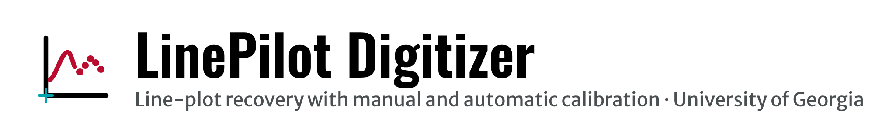
</p>

<p align="center">
  <a href="https://arxiv.org/abs/2609.19377"></a>
  <a href="https://rayana07.github.io/LinePilot/"></a>
  <a href="https://github.com/RayanA07/LinePilot/releases/latest"></a>
  <a href="#digitizerbench"></a>
</p>

**LinePilot Digitizer** turns a *picture* of a line plot — a figure from a paper, a scanned chart, a screenshot — into the *numbers* behind it. It reads the axes, follows each colored curve column by column, and exports a CSV plus an overlay image so you can check its work at a glance.

It offers three calibration modes that share one curve-recovery procedure:

| Mode | How the axes are calibrated | Best for |
| --- | --- | --- |
| **LinePilot (standard)** | You click four axis ticks (X min, X max, Y min, Y max); the clicks are used as is. | Full manual control. |
| **LinePilot (enhanced)** | Same four clicks, each snapped to the nearest tick / axis stroke at sub-pixel precision — only when the image supports it. | Best accuracy with human guidance. Lowest error of every tool we tested on DigitizerBench-Lite. |
| **LinePilot (OCR)** | Axis labels are read with Tesseract (and RapidOCR when available), paired with ticks, and checked for a consistent scale. No clicks. | Batch processing and fully automatic pipelines. Best of the automatic tools on DigitizerBench-Full. |

The paper also introduces **[DigitizerBench](#digitizerbench)**, the first benchmark designed specifically to evaluate plot digitizers end to end.

<p align="center">
  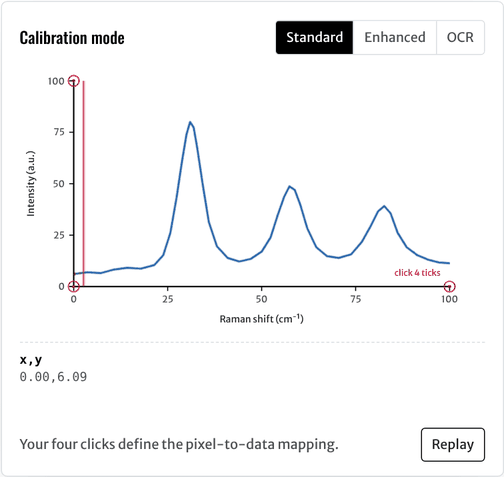<br>
  <sub>Column-by-column color matching, linked by dynamic programming into one continuous path per curve.</sub>
</p>

> **Paper:** Fengbo Ma\*, Rayan Akhtar\*, Aakash H. Joshi\*, Xiaoting Li, Haijian Sun, Zhen Xiang†, Xianyan Chen†, Yiping Zhao†.
> *LinePilot Digitizer: Line-Plot Recovery with Manual and Automatic Calibration.* arXiv:2609.19377, 2026.
> [[arXiv](https://arxiv.org/abs/2609.19377)] · [[PDF](https://arxiv.org/pdf/2609.19377)] · [[Online appendix](docs/assets/LinePilot_Online_Appendix.pdf)] · [[Website](https://rayana07.github.io/LinePilot/)] · [[Cite](#citation)]

---

## Contents

- [How it works](#how-it-works)
- [Results](#results)
- [Install](#install)
- [Using the desktop app](#using-the-desktop-app)
- [Command line, batch mode and Python API](#command-line-batch-mode-and-python-api)
- [DigitizerBench](#digitizerbench)
- [Repository layout](#repository-layout)
- [Citation](#citation)
- [Acknowledgment](#acknowledgment)

---

## How it works

<p align="center">
  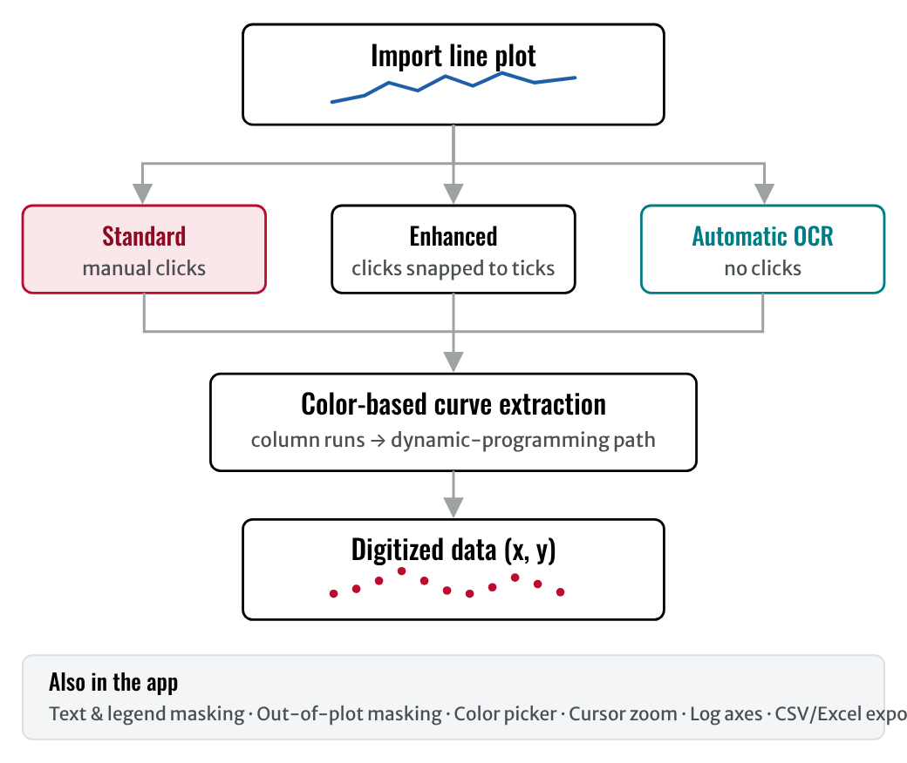
</p>

Digitization is two problems. **Calibration** maps image pixels to data coordinates — a calibration error shifts every recovered point. **Curve recovery** follows the plotted line, which is a continuous path rather than a cloud of independent pixels. LinePilot keeps the recovery stage fixed and lets you choose how calibration happens.

**Calibration.** For either linear axis, two anchors *(p₁, q₁)* and *(p₂, q₂)* define *q = q₁ + (p − p₁)(q₂ − q₁)/(p₂ − p₁)*, applied horizontally to *(u, x)* and vertically to *(v, y)*. The three modes differ only in where the anchors come from: your raw clicks (standard), your clicks refined to the tick center from local image intensity (enhanced), or OCR'd tick labels paired with detected ticks and filtered for a consistent scale (OCR). OCR mode reports failure rather than guessing when the required endpoints can't be established. Log-scale axes are supported in every mode.

**Curve extraction.** Target colors are detected automatically or picked by you. In each image column, pixels within a color tolerance are grouped into vertical runs; each run's midpoint is a candidate center-line position and its thickness is extra stroke evidence. Dynamic programming links candidates across columns, rewarding sustained support and penalizing abrupt vertical jumps and gaps, so isolated color-matched objects lose to the real line. Only image-supported points are exported — missing columns are never filled with synthesized values.

Also in the app: text and legend masking, out-of-plot masking, a color picker with multiple color slots, cursor zoom, Ctrl+Z for calibration clicks, CSV / Excel export, and a batch CLI.

---

## Results

One example from DigitizerBench (`D0001-overlapping-altair`, Fig. 1b in the paper): an overlapping two-line plot digitized by the state-of-the-art automatic tool, the state-of-the-art manual tool, and the three LinePilot modes.

| Original plot | ChartOCR | LinePilot (OCR) |
| :---: | :---: | :---: |
|  | 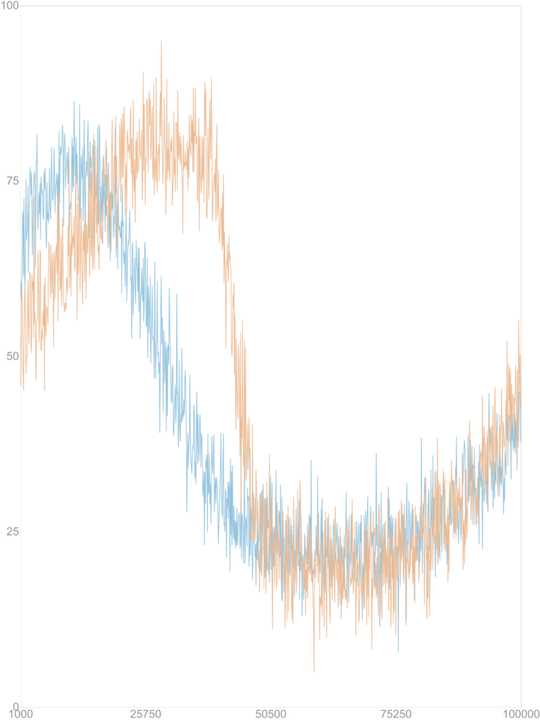 | 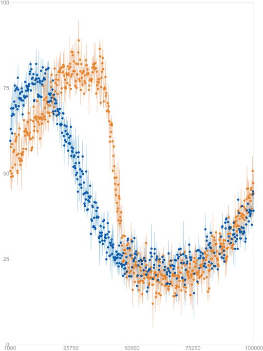 |
| two noisy series, Altair | **no output** | both series, fully automatic |

| PlotDigitizer Pro | LinePilot (standard) | LinePilot (enhanced) |
| :---: | :---: | :---: |
| 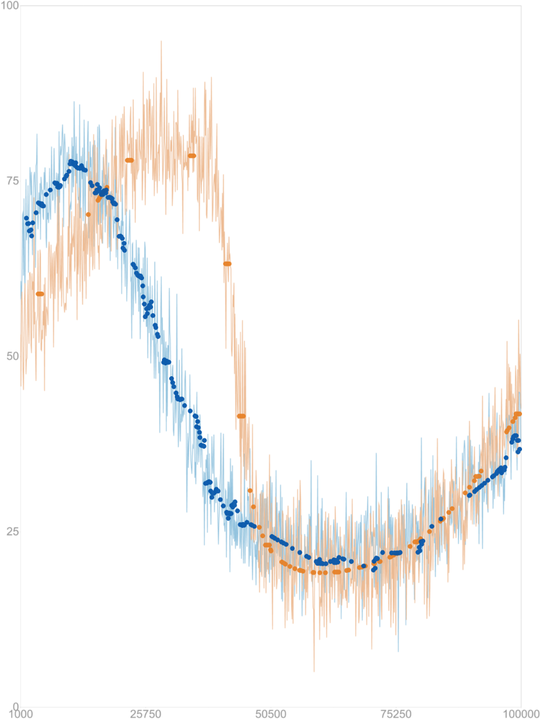 | 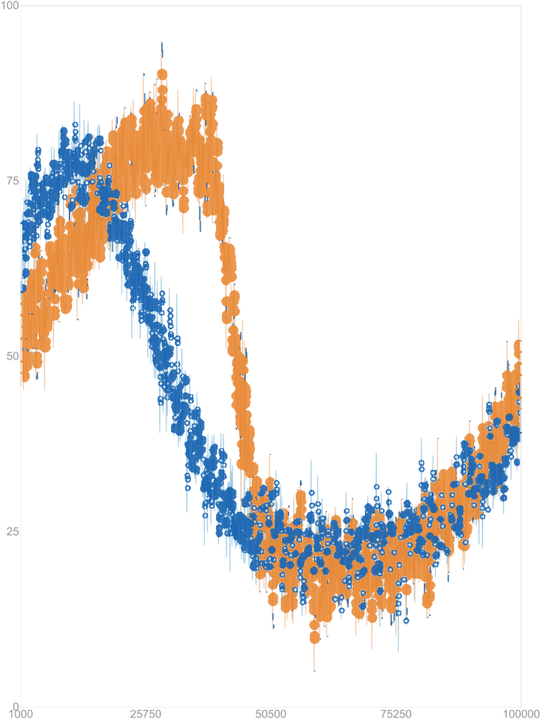 | 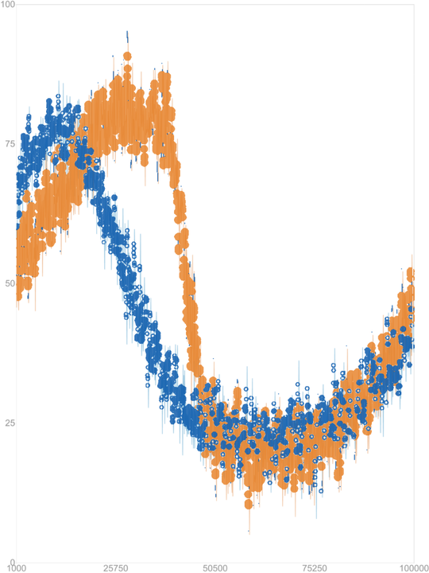 |
| sparse manual points | dense, 4 clicks | dense, 4 snapped clicks |

**Automatic pipelines — DigitizerBench-Full (2,980 images per method)**

| Method | FPC-NRMSE ↓ | Output success ↑ | Trusted usability ↑ | Points per line ↑ |
| --- | ---: | ---: | ---: | ---: |
| ChartOCR | 0.953 | 30.2 % | 5.4 % | 29 |
| LineEX | 0.997 | 36.6 % | 0.4 % | 14 |
| **LinePilot (OCR)** | **0.672** | **55.1 %** | **38.2 %** | **1,180** |

**Human-guided tools — DigitizerBench-Lite (60 images per method)**

| Method | FPC-NRMSE ↓ | Output success ↑ | Trusted usability ↑ | Points per line ↑ |
| --- | ---: | ---: | ---: | ---: |
| PlotDigitizer Pro | 0.097 | 100 % | 91.7 % | 475 |
| WebPlotDigitizer | 0.164 | 98.3 % | 86.7 % | 195 |
| Engauge Digitizer | 0.790 | 55.0 % | 23.3 % | 235 |
| **LinePilot (standard)** | 0.101 | **100 %** | 91.7 % | 1,025 |
| **LinePilot (enhanced)** | **0.081** | **100 %** | **93.3 %** | **1,027** |

*FPC-NRMSE* (failure-penalized capped normalized RMSE) assigns a full unit of error to any image whose output is missing, structurally unusable or catastrophically wrong, so it measures reliability as well as accuracy. *Trusted usability* requires the correct line count, finite error on every match, at least 20 valid points and ≥ 80 % coverage. Values are from Table 3 of the paper; the full comparison with LineEX, WebPlotDigitizer and Engauge Digitizer on the example above is in the [online appendix](docs/assets/LinePilot_Online_Appendix.pdf).

---

## Install

### Windows — no Python needed

1. Open the **[latest release](https://github.com/RayanA07/LinePilot/releases/latest)** and download **`Digitizer.exe`** from *Assets*. (Optional: `AccuracyTester.exe`, see below.)
2. Double-click it. Nothing to install — the Tesseract OCR engine is bundled inside.
3. On first run Windows SmartScreen may say *"Windows protected your PC"*. Click **More info → Run anyway**. The app simply isn't code-signed.

> If double-clicking does *nothing at all* — no window, no warning — **Smart App Control** (on by default on new Windows 11 installs) is silently blocking unsigned programs. Run from source instead (below); that path is not blocked. Turning Smart App Control off is a one-way door, so prefer running from source.

### macOS

A `Digitizer.app` bundle is built from the companion **[digitizer_mac](https://github.com/RayanA07/digitizer_mac)** repository (`bash build_macos.sh`), which also builds automatically on GitHub Actions.

### From source (Windows / macOS / Linux)

```bash
git clone https://github.com/RayanA07/LinePilot.git
cd LinePilot/Digitizer
python -m pip install -r requirements.txt     # PyQt6, numpy, pillow, pytesseract, openpyxl, PyInstaller
python digitizer_2_11.py                      # launches the GUI
```

Running from source needs the **Tesseract** program installed for OCR features (`pytesseract` alone is not enough); the prebuilt `.exe` bundles it. On Windows, `build.cmd` rebuilds `dist\Digitizer.exe` with PyInstaller.

---

## Using the desktop app

> The complete reference — every menu, option and error message — is in **[`Digitizer/README.md`](Digitizer/README.md)**. This walkthrough digitizes one figure end to end; the screenshots are of the real app (`docs/assets/tutorial/`), using `sample_plot.png` from that folder if you want to follow along.

### Step 0 — Open the app

Double-click `Digitizer.exe`. Everything you need is in the four menus along the top — **Import, Tools, Advanced, Export** — worked left to right. The thin **status bar** at the very bottom confirms every action or tells you why something didn't run, so keep an eye on it. **Cursor Zoom** (top right) is a live magnifier of whatever is under your mouse, handy for clicking ticks precisely. **About ▾** (top right) holds the citation and acknowledgments.

<p align="center">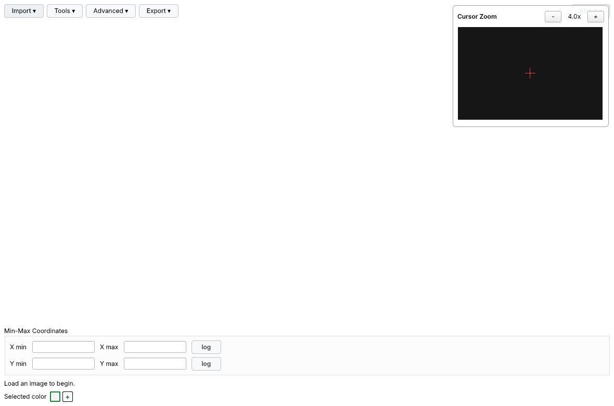</p>

### Step 1 — Import your plot

**Import ▾ → Import Image** and pick a PNG / JPG / BMP / TIF, or copy a screenshot and use **Paste Image**.

<p align="center">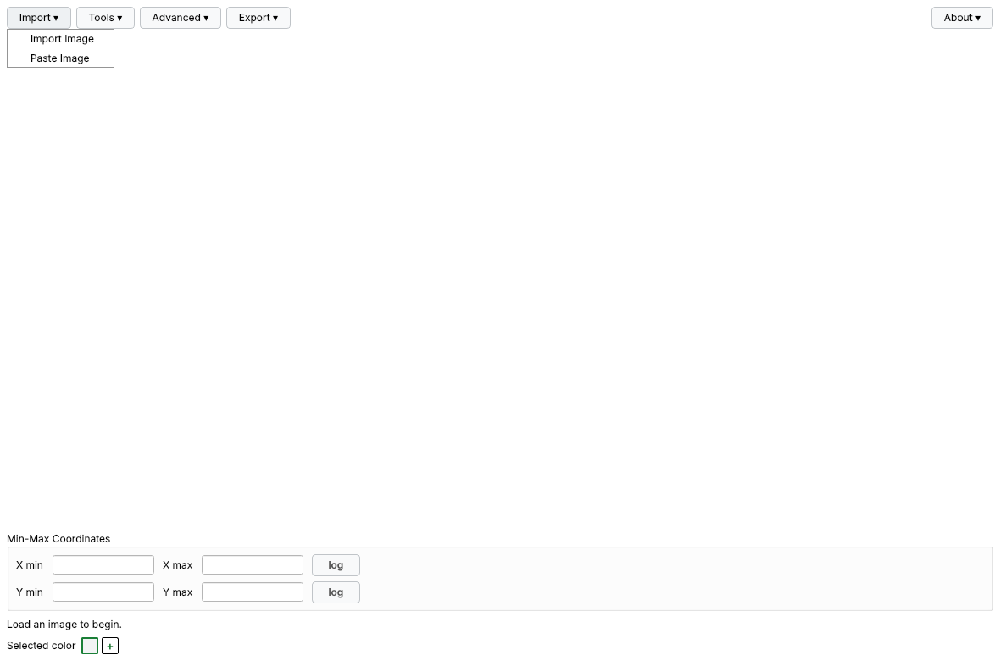</p>

The figure appears in the main area. LinePilot immediately guesses the curve color and shows it as the first square in the **Selected color** row at the bottom; the status bar reports `Auto-selected color: (31, 95, 168)`.

<p align="center">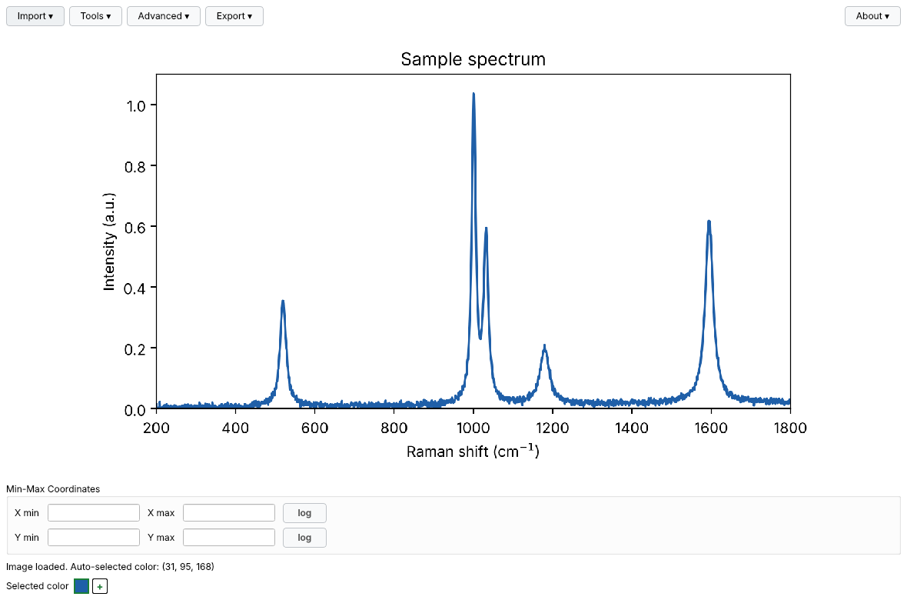</p>

If it picked the wrong color — a gridline, say — use **Tools ▾ → Pick Color** and click directly on your curve. To trace a second curve, press the green **+** in the Selected color row, select the new slot and Pick Color again.

> **Tip:** resolution is the single biggest factor in accuracy. A figure under ~700 px wide gives OCR only a few pixels per digit; re-export it at a higher DPI if you can.

### Step 2 — Read the axes (OCR mode)

**Advanced ▾ → Axis Scale Detection → Run Axis Detection.**

<p align="center">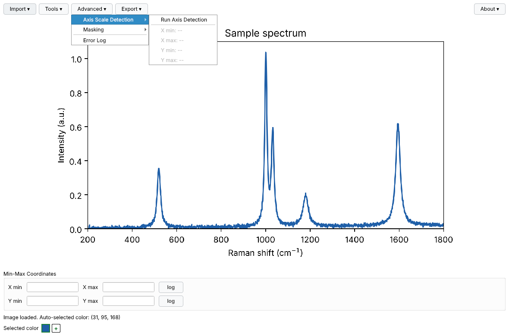</p>

LinePilot finds the plot region, reads the tick labels on both axes with OCR, and fills the four **Min-Max Coordinates** boxes — here `X 200 → 1800`, `Y 0 → 1.0`. The orange marks on the image show which tick labels it locked on to.

<p align="center">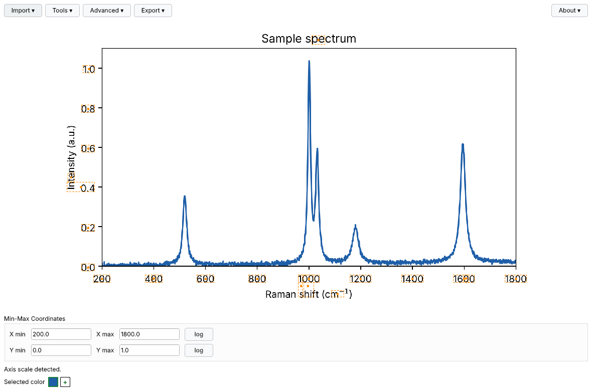</p>

**Always glance at the four boxes.** OCR is good, not perfect — a dropped minus sign or a misread `8`/`0` would silently rescale every exported value. If anything is off, just type the correct number into the box.

### Step 3 — Calibrate

Calibration tells LinePilot exactly where the plotted area sits in the image. **Tools ▾ → Calibration** offers both routes:

<p align="center">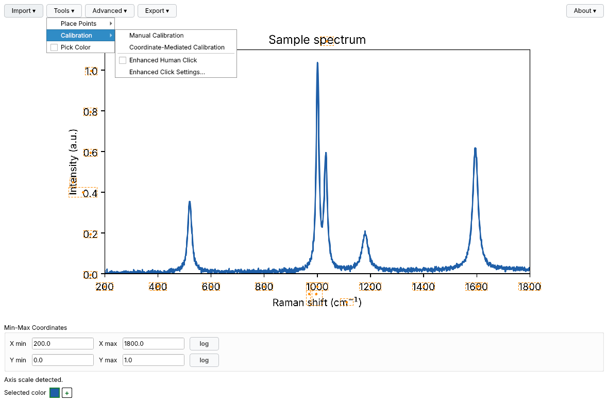</p>

**OCR route — Coordinate-Mediated Calibration.** Because you ran Axis Detection, this snaps a dashed green box onto the plot area automatically. Nothing to click.

<p align="center">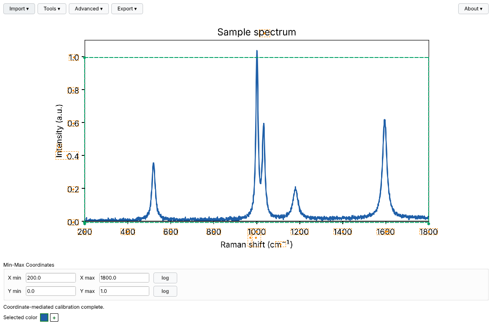</p>

**Manual route — Manual Calibration (standard / enhanced).** A green banner walks you through four clicks on the image: **X MIN → X MAX → Y MIN → Y MAX**. You are clicking *positions on the picture* (the tick marks), not typing numbers.

<p align="center">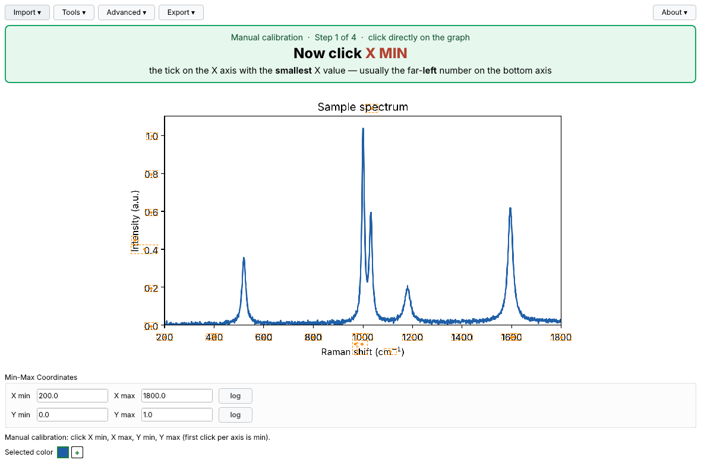</p>

Turn on **Enhanced Human Click** first and each click is snapped to the center of the nearest tick or axis stroke, at sub-pixel precision. The status bar says exactly what happened — *"vertical line found, corrected x by 0.03 px"* — and a click with no feature nearby is left exactly where you put it. **Ctrl+Z** undoes the last click.

<p align="center">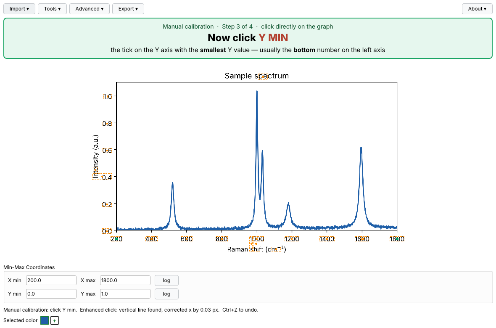</p>

After the fourth click the banner turns to **Manual calibration complete** and the green box is drawn. In manual mode, type the four axis values into the Min-Max boxes yourself (or run Axis Detection to fill them).

<p align="center">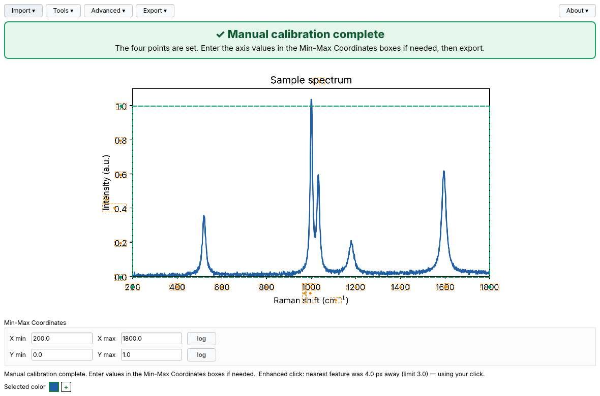</p>

If the box doesn't sit exactly on your axes, hover over an edge until the cursor becomes a resize arrow and drag it.

### Step 4 — Mask anything that isn't data *(optional)*

If a legend, label or annotation shares the curve's color, blank it out first: **Advanced ▾ → Masking** can erase detected text and numbers automatically, hide everything outside the plot box, or let you draw mask rectangles by hand (**Manual Mask Mode**). **Clear Masks** undoes them.

### Step 5 — Place points

**Tools ▾ → Place Points → Run.**

<p align="center">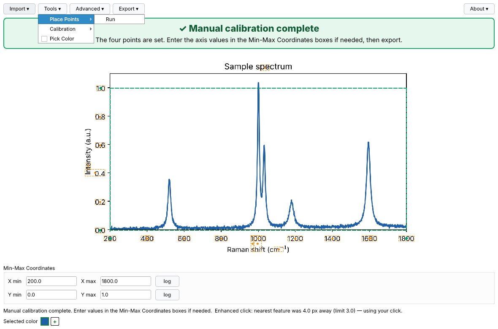</p>

LinePilot scans every image column for the selected color, links the matches into one continuous path, and overlays the result on your figure in the inverse color so you can check it at a glance. The status bar reports the count — here *1,199 points*.

<p align="center">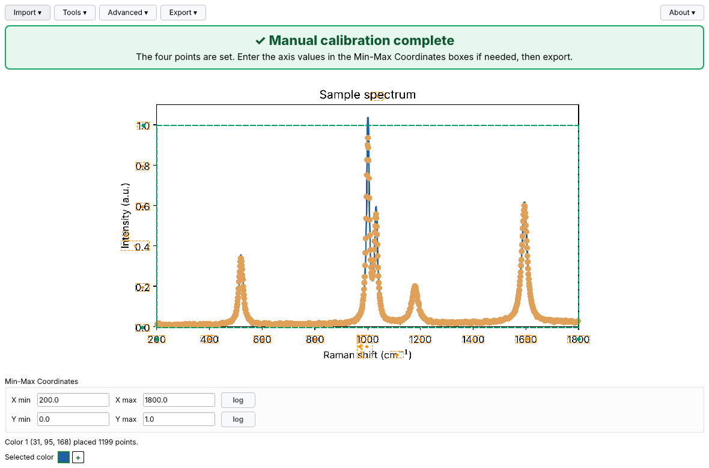</p>

Points are not clipped to the calibration box by default — a tick read slightly short would otherwise cut the ends off your curve. (The CLI flag `--limit-to-calibration` turns clipping on.)

### Step 6 — Export

**Export ▾ → Export CSV → Raw values** (or **Export Excel** for an `.xlsx`). With several curves, tick the slots you want under **Colors to Export**. A normal Save dialog opens; note the folder.

<p align="center">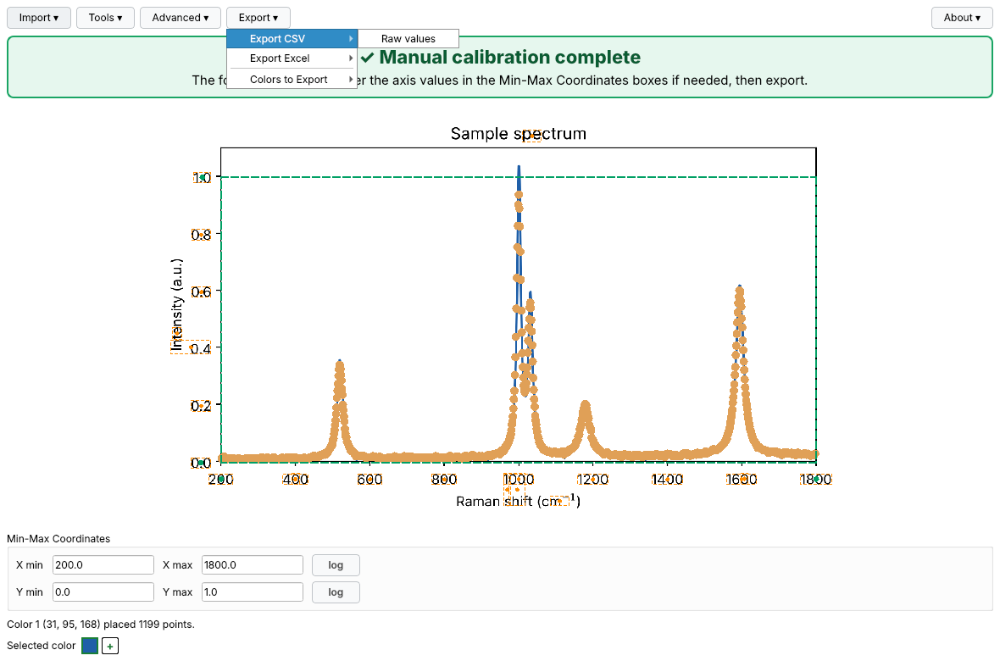</p>

Each row is one point: the color slot, its RGB, the **data value** and the original **pixel position**.

```csv
color_slot,color_r,color_g,color_b,x,y,x_px,y_px
1,31,95,168,201.040769,0.015625,138.0,706.0
1,31,95,168,202.390300,0.011285,139.0,708.5
1,31,95,168,203.729423,0.009549,140.0,709.5
```

The command line additionally writes an overlay image next to the CSV — the calibration box, the OCR regions and every extracted point drawn on your figure:

<p align="center">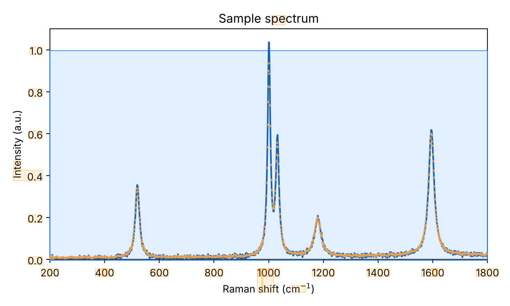</p>

Export needs both the four Min-Max boxes filled **and** a calibration; if either is missing the status bar says so.

### Log-scale axes

Flip the small **log** buttons beside the X or Y Min-Max boxes (they turn green) and enter the axis values exactly as printed on the plot (e.g. `1` and `1000`). Values must be positive.

### About, citation and acknowledgments

**About ▾** in the top-right corner opens the credits: authors and links, a **Cite** tab with a one-click **Copy BibTeX**, the NSF POSE / SpectraGuru acknowledgment, and third-party licenses.

<p align="center">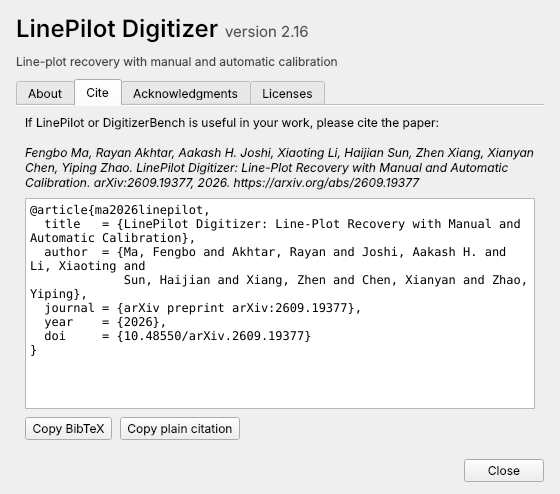</p>

---

## Command line, batch mode and Python API

All three run from the source folder (`LinePilot/Digitizer`) with Python installed.

```bash
# one image, everything auto-detected (OCR calibration), output to Downloads
python digitizer.py graph.png

# give the axis values yourself, read Y on a log scale, choose the output folder
python digitizer.py graph.png --axis 0,10,0,100 --log-y --out results/

# force the curve color (R,G,B) and show the OCR confidence + full log
python digitizer.py graph.png --color 130,5,255 --verbose 1

# a whole folder: digitized_csvs/, digitized_overlays/ and a batch_report.csv/.json
python digitizer_batch_cli.py figures/ --out digitized/

# score digitized CSVs against reference CSVs, matched by file name
python ../AccuracyTester/accuracy_batch_cli.py --digitized-dir digitized/digitized_csvs --ground-truth-dir truth/ --out scores/
```

Every run writes `<image>_digitized_points.csv` and `<image>_digitized_overlay.png`; `--verbose 1` adds `<image>_log.txt` with the OCR confidence score — a low score is a hint to pass `--axis` yourself. Run `python digitizer.py --help` for every option (`--ticks`, `--log-x`, `--json`, `--normalize-y`, `--limit-to-calibration`, …).

```python
from digitizer_api import digitize_image

out = digitize_image("graph.png",
                     axis_values=(0, 10, 0, 100),   # None → read by OCR
                     color_rgb=None,                # None → auto-detect
                     output_dir="results")
out.csv_path, out.overlay_path, out.point_count, out.used_ocr, out.ocr_confidence
```

### Accuracy Tester

A separate, optional tool (`AccuracyTester.exe`, or `python accuracytester_desktop.py` from `AccuracyTester/`) that measures how faithfully a digitized curve reproduces a reference curve: MAE, RMSE, R², bias, MAPE / sMAPE / WAPE, with overlay, residual and outlier plots, optional constant X-shift optimization, and CSV export. `accuracy_batch_cli.py` scores whole folders.

---

## DigitizerBench

DigitizerBench evaluates digitizers under **controlled, orthogonally balanced** variation of signal, rendering and plot-structure factors, so you can see *which* factors break a tool — not just how often it breaks.

| | |
| --- | --- |
| **DigitizerBench-Full** | 2,980 images: a 2,500-image orthogonal-array core (four strength-3 OA(625, 19, 5, 3) panels) plus 480 matched *bridge* renderings. For automatic evaluation and main-effects ANOVA. |
| **DigitizerBench-Lite** | 60 outcome-independent core images, each rendered under all nine plot-type × renderer combinations. For human-guided evaluation on identical plots. |
| **Signal factors (8 × 5 levels)** | Baseline family and magnitude; extrema count and prominence; feature width, sharpness and asymmetry; signal noise. |
| **Rendering factors (10 × 5 levels)** | Line thickness and color; DPI; blur; figure width and aspect ratio; tick-label size and tick count; X- and Y-axis ranges. |
| **Structure** | Single, overlapping and stacked plots with 1, 2, 3 or 5 lines; rendered with Matplotlib, Plotly and Altair. |
| **Ground truth** | Exact curve and tick coordinates for every image, plus the master seed, factor levels, orthogonal-array matrices, trace-generation rules, bridge identifiers, software versions and image manifest needed to regenerate it. |

**What it found.** For automatic digitization, image presentation matters far more than signal complexity: figure width has the largest effect, then DPI and renderer; noise and most curve-shape factors are not significant, and width × DPI interact. For human-guided digitization, one-pixel lines are the main failure mode — performance stabilizes at 3–5 px.

**Download:** the benchmark package will be released on Hugging Face — *link coming soon*. <!-- TODO: https://huggingface.co/datasets/… -->

---

## Repository layout

```text
LinePilot/
├── Digitizer/           # desktop app (PyQt6), CLI, batch CLI and Python API
│   ├── digitizer_2_11.py    GUI entry point
│   ├── digitizer.py         CLI launcher
│   ├── digitizer_batch_cli.py
│   ├── digitizer_api.py     digitize_image(...)
│   ├── Calibration.py / EnhancedClick.py / AxisReader.py / PointPlacer.py / Masking.py
│   └── build.cmd            one-click Windows build (PyInstaller)
├── AccuracyTester/      # reference-vs-digitized scoring app and batch CLI
├── docs/                # project website (GitHub Pages) and figures used in this README
├── CHANGELOG.md
└── CITATION.cff
```

This repository carries the full commit history of the project. Earlier releases (2.11 – 2.15, published as *Data Digitizer*) are at [aj24by7/DataDigitizer](https://github.com/aj24by7/DataDigitizer); the [changelog](CHANGELOG.md) covers every version.

---

## Citation

If LinePilot or DigitizerBench is useful in your work, please cite the paper — and star the repo, open an issue, or tell us how it went.

```bibtex
@article{ma2026linepilot,
  title   = {LinePilot Digitizer: Line-Plot Recovery with Manual and Automatic Calibration},
  author  = {Ma, Fengbo and Akhtar, Rayan and Joshi, Aakash H. and Li, Xiaoting and
             Sun, Haijian and Xiang, Zhen and Chen, Xianyan and Zhao, Yiping},
  journal = {arXiv preprint arXiv:2609.19377},
  year    = {2026},
  doi     = {10.48550/arXiv.2609.19377}
}
```

\* Equal contribution. † Corresponding authors: zhaoy@uga.edu, zxiangaa@uga.edu, xychen@uga.edu.

## Acknowledgment

This work was supported by the National Science Foundation through the Pathways to Open-Source Ecosystems (POSE) program, award No. 2518273. The authors gratefully acknowledge the support, guidance and collaboration of all members of the SpectraGuru™ development and stakeholder teams. LinePilot is part of the open-source ecosystem for Raman and SERS spectroscopy developed in the Zhao lab at the University of Georgia and its collaborators at the University of Pennsylvania.
